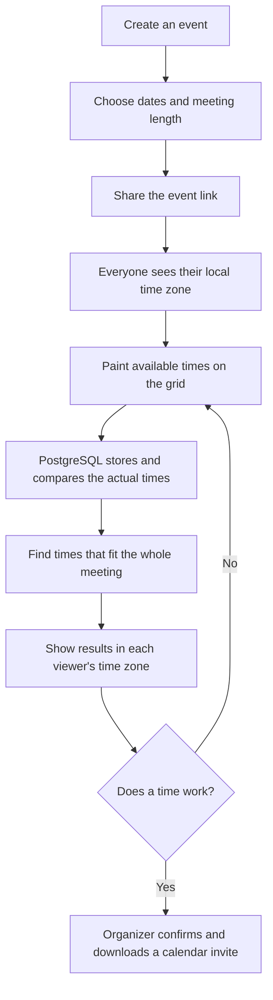

# Whenkin

**Find your shared time.**

Whenkin helps a group choose a time to meet. Create an event, share its link, and let everyone mark when they are free. Whenkin then suggests times that fit the most people for the whole meeting.

The website works on computers and phones. You do not need an account to respond.

## What it does

New here? The website’s **How it works** guide explains what the organizer and participants do.

- Choose English (default), 简体中文, or Español. The website remembers your choice and updates the date and time labels too.
- Paint your free time onto a grid with a mouse or finger.
- Zoom in, see exact times while selecting, adjust the start and end, and undo mistakes.
- Automatically show your device’s time zone. Search for another city or time zone whenever you need to.
- See the group’s availability and suggested meeting times.
- Save changes automatically after entering your name.
- Confirm a final time and download a calendar invitation.
- Use private links to manage an event or edit your own response from another device.

Anyone with an event link can see the group’s names and availability. Keep organizer and response-edit links private.

## How it works

More diagrams: [How the website works](docs/flowchart.md).

## Time zones, without extra copies

Availability uses PostgreSQL’s `timestamptz` type for its start and end. PostgreSQL handles comparisons between different time zones. We do not store separate local-time copies.

An event and a response each have one time-zone preference. Changing the display zone changes the labels, not the actual availability. Dates and daylight saving changes are taken into account.

## Built with

- React and TypeScript for the website.
- ChatGPT Sites for managed website and API hosting.
- Neon PostgreSQL for saved events and responses.

Private test site: https://whenkin.j4ouyang.chatgpt.site

## Hosting and saved data

ChatGPT Sites manages the website, API, versions, runtime secrets, and publishing. The existing Neon project stores events, responses, availability, and confirmed meeting times. Neon does not need to be deployed on another host. The database connection is configured as the server-only `DATABASE_URL` secret in Sites.

The Site starts private for owner testing. Its audience must be made public before an anonymous participant can use a shared event link.

## Run it locally

Use Node.js 22 or newer. Install dependencies using the included installer, configure a local ignored `.dev.vars` file with `DATABASE_URL`, then run `npm run dev`. The application uses the existing database schema in `migrations/`.

## Verify

Run `npm run check`, `npm test`, and `npm run build`. The tests cover time zones, daylight saving changes, complete meeting windows, event and response permissions, network errors, and all three website languages.

## Source and documentation

The original source is at https://github.com/jimmy181211/whenkin. This Sites checkout retains the existing design and scheduling logic, with a managed hosting entry point. See `docs/flowchart.md` for the complete flow.
