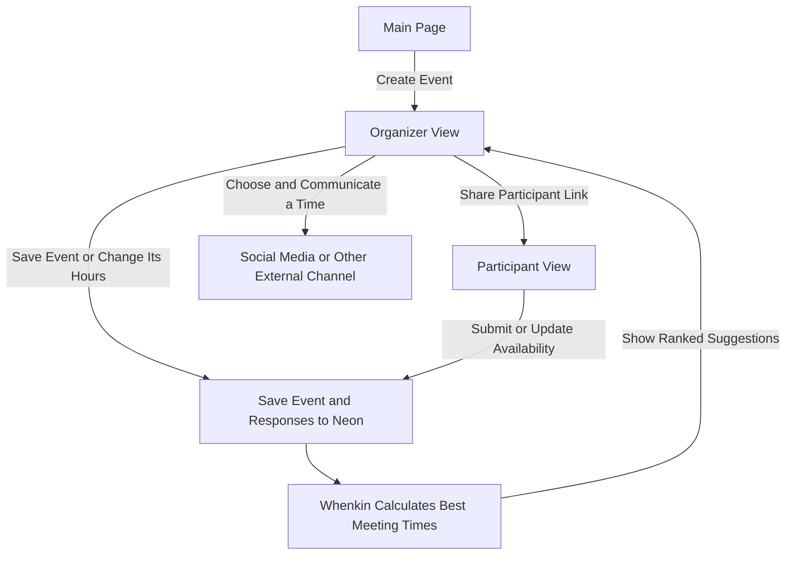
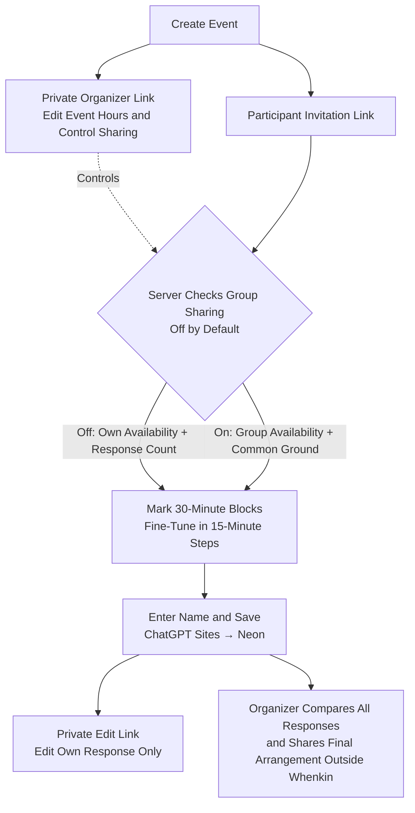

# Whenkin

**Find your shared time.**

Whenkin helps a group choose a time to meet. Create an event, share its link, and let everyone mark when they are free. Whenkin then suggests times that fit the most people for the whole meeting.

## Big Picture

Responses and event changes update the same saved event, and suggestions return to the organizer. See [Participant Privacy](docs/flowchart.md#participant-privacy), [Website and Storage](docs/flowchart.md#website-and-storage), and [Editing and Navigation](docs/flowchart.md#editing-and-navigation) for the details.

The website works on computers and phones. You do not need an account to respond.

## What It Does

See the [participant privacy flow](docs/flowchart.md#participant-privacy) for organizer and participant access rules.

- Choose English (default), 简体中文, or Español. The website remembers your choice and updates the date and time labels too.
- Paint 30-minute blocks with a mouse or finger, then fine-tune in 15-minute increments.
- Zoom in, see exact times while selecting, adjust the start and end, and undo mistakes.
- Automatically show your device’s time zone. Search for another city or time zone whenever you need to.
- Organizers see all responses and suggested meeting times. Participants see only their own response and the count unless the organizer enables group sharing.
- Save changes automatically after entering your name.
- Communicate the final arrangement outside Whenkin.
- Use private links to manage an event or edit your own response from another device.

Group sharing is off by default. While it is off, participants see their own availability and the response count; the API excludes other respondents’ names, time zones, availability, and common-ground suggestions. The organizer always sees all responses. Turning sharing on reveals the group view but never lets participants edit someone else’s response. Organizer and response-edit links remain private.

## How It Works

More diagrams: [How the website works](docs/flowchart.md).

## Time Zones, Without Extra Copies

Availability uses PostgreSQL’s `timestamptz` type for its start and end. PostgreSQL handles comparisons between different time zones. We do not store separate local-time copies.

An event and a response each have one time-zone preference. Changing the display zone changes the labels, not the actual availability. Dates and daylight saving changes are taken into account.

## Built With

- React and TypeScript for the website.
- ChatGPT Sites for managed website and API hosting.
- Neon PostgreSQL for saved events and responses.

Public website: https://whenkin.j4ouyang.chatgpt.site

## Hosting and Saved Data

ChatGPT Sites manages the website, API, versions, runtime secrets, and publishing. The existing Neon project stores events, responses, availability, and group-sharing settings. Neon does not need to be deployed on another host. The database connection is configured as the server-only `DATABASE_URL` secret in Sites.

The Site is public. Its audience is independent of each event’s server-enforced organizer, participant, and response-edit permissions.

## Run It Locally

Use Node.js 22 or newer. Install dependencies using the included installer, configure a local ignored `.dev.vars` file with `DATABASE_URL`, then run `npm run dev`. Apply migrations in numeric order. `002_participant_privacy.sql` adds a non-null privacy flag with a default of false, preserving existing events and selections. Apply it before deploying the corresponding API.

## Verify

Run `npm run check`, `npm test`, and `npm run build`. The tests cover time zones, daylight saving changes, complete meeting windows, event and response permissions, network errors, and all three website languages.

## Source and Documentation

The original source is at https://github.com/jimmy181211/whenkin. This Sites checkout retains the existing design and scheduling logic, with a managed hosting entry point. See `docs/flowchart.md` for the complete flow.

Organizer schedule edits require `003_schedule_revision.sql` before the new API is deployed. It adds a positive schedule revision counter without changing existing event windows or availability. The organizer can edit From, Until, and Meeting Length; unchanged participant links reflect new windows and retain availability only where it still fits. Run `npm run lint -- --max-warnings 0` alongside the other verification commands.
