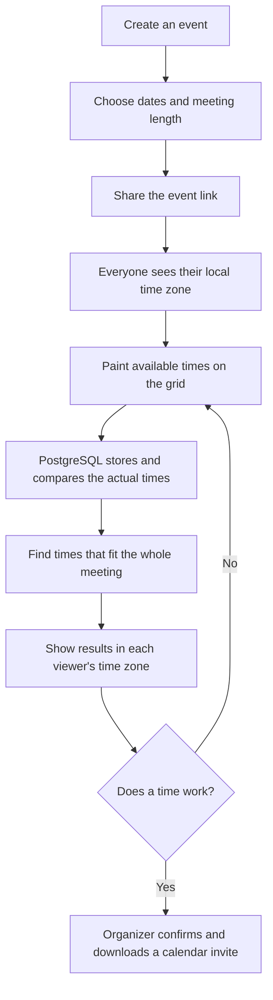

# Whenkin

**Find your shared time.**

Whenkin helps a group choose a time to meet. Create an event, share its link, and let everyone mark when they are free. Whenkin then suggests times that fit the most people for the whole meeting.


The website works on computers and phones. You do not need an account to respond.

## What it does

New here? The website’s **How it works** guide explains what the organizer and participants do.

- Choose English (default), 简体中文, or Español. The website remembers your choice and updates the date and time labels too.
- Paint your free time onto a grid with a mouse or finger.
- Zoom in, see exact times while selecting, adjust the start and end, and undo mistakes.
- Automatically show your device’s time zone. Search for another city or time zone whenever you need to.
- See the group’s availability and suggested meeting times.
- Save changes automatically after entering your name.
- Confirm a final time and download a calendar invitation.
- Use private links to manage an event or edit your own response from another device.

Anyone with an event link can see the group’s names and availability. Keep organizer and response-edit links private.

## How it works



More diagrams: [How the website works](docs/flowchart.md).

## Time zones, without extra copies

Availability uses PostgreSQL’s `timestamptz` type for its start and end. PostgreSQL handles comparisons between different time zones. We do not store separate local-time copies.

An event and a response each have one time-zone preference. Changing the display zone changes the labels, not the actual availability. Dates and daylight saving changes are taken into account.

## Built with

- React and TypeScript for the website.
- Cloudflare Workers for the website and API.
- Neon PostgreSQL for saved events and responses.

## Run it locally

You need Node.js 22 or newer, npm, and a Neon database.

```sh
npm ci
cp .dev.vars.example .dev.vars
```

Put your Neon connection string in `.dev.vars`. This file is ignored by Git. Load the same connection string into your shell as `DATABASE_URL`, then run:

```sh
npm run migrate
npm run build
npm run dev:api
```

In another terminal, run `npm run dev` and open the address Vite prints. Until the API and database are connected, event creation shows a setup notice and stays disabled.

## Check the project

```sh
npm run check
npm test
npm run build
```

Tests cover time-zone conversions, daylight saving changes, whole-meeting matching, private edit links, concurrent edits, and the API against a local PostgreSQL engine.

## Publish on Cloudflare

See [Setup and deployment](docs/setup.md). Cloudflare provides a free public `workers.dev` address, so a purchased domain is not required. Free services have usage limits.

Never commit database passwords or Cloudflare tokens. Store the database connection string as a Worker secret.
