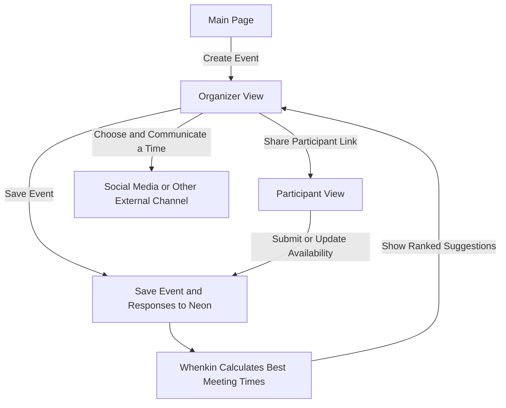
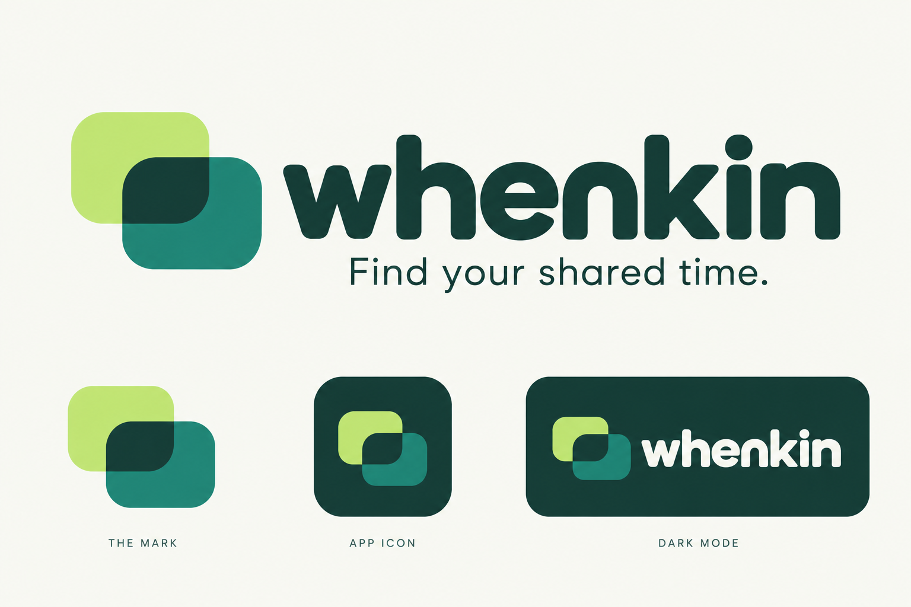
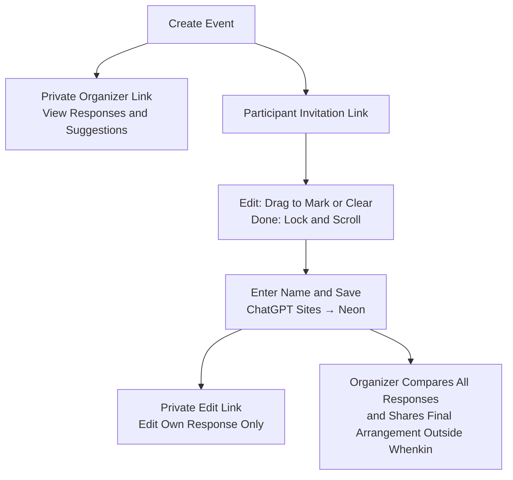

# Whenkin

**Find your shared time.**

Whenkin helps a group choose a time to meet. Create an event, share its link, and let everyone mark when they are free. Whenkin then suggests times that fit the most people for the whole meeting.

## Big Picture

Responses and event changes update the same saved event, and suggestions return to the organizer. See [Calculating the Best Meeting Time](docs/flowchart.md#calculating-the-best-meeting-time), [Participant Privacy](docs/flowchart.md#participant-privacy), [Website and Storage](docs/flowchart.md#website-and-storage), and [Editing and Navigation](docs/flowchart.md#editing-and-navigation) for the details.

The website works on computers and phones. You do not need an account to respond. Event titles are required; organizer names are optional. On phones, the brief instructions live on a separate “How it works” page linked from the homepage, keeping the event form concise. Desktop keeps the three steps alongside the form.

## What It Does

See the [participant privacy flow](docs/flowchart.md#participant-privacy) for organizer and participant access rules.

- Choose English (default), 简体中文, or Español. The website remembers your choice and updates the date and time labels too.
- Choose specific dates for a one-time event, or Monday–Sunday for a typical-week availability poll. Switch modes without losing your selections.
- In Edit, start dragging on a blank block to mark availability, or on a marked block to clear it. Choose Done to lock the grid and scroll. The same controls work on computers and phones.
- Zoom in, see exact times while selecting, and undo mistakes. The former fine-tune panel has been removed.
- Date-based events show your device’s time zone, with a searchable selector. Typical-week polls also have the searchable selector. Their conversions use the time-zone offsets when the poll was created; daylight-saving changes can alter the difference.
- Organizers see all responses and suggested meeting times. Participants see only their own response and the count.
- Enter your name before editing availability. An edit attempt without a name focuses the name field and shows a notice directly under it. Changes save automatically after that.
- Communicate the final arrangement outside Whenkin.
- Use private links to manage an event or edit your own response from another device.

Participants see only their own availability and the response count. The API excludes other respondents’ names, time zones, availability, and meeting suggestions. The organizer always sees all responses and suggestions. Organizer and response-edit links remain private. There is no group-view switch or sharing setting.

## How It Works

More diagrams: [How the website works](docs/flowchart.md).

## Time Zones, Without Extra Copies

For date-based events, availability uses PostgreSQL’s `timestamptz` type for its start and end. PostgreSQL handles comparisons between different time zones. We do not store separate local-time copies.

An event and a response each have one time-zone preference. For date-based events, changing the display zone changes the labels, not the actual availability. Dates and daylight saving changes are taken into account. Weekday polls use a fixed reference for time-zone conversion, as explained below.

## Built With

- React and TypeScript for the website.
- ChatGPT Sites for managed website and API hosting.
- Neon PostgreSQL for saved events and responses.

Public website: https://whenkin.j4ouyang.chatgpt.site

## Hosting and Saved Data

ChatGPT Sites manages the website, API, versions, runtime secrets, and publishing. The existing Neon project stores events, responses, and availability. Neon does not need to be deployed on another host. The database connection is configured as the server-only `DATABASE_URL` secret in Sites.

The Site is public. Its audience is independent of each event’s server-enforced organizer, participant, and response-edit permissions.

## Terms and Privacy

[Terms of Use](https://whenkin.j4ouyang.chatgpt.site/terms) and [Privacy Policy](https://whenkin.j4ouyang.chatgpt.site/privacy) are available from every page’s footer in English, Simplified Chinese, and Spanish. UCSD CSSA operates Whenkin; privacy and deletion requests go to j4ouyang@ucsd.edu. The policies describe the current access controls, local drafts and credentials, hosting providers, and absence of automatic event expiry.

## Run It Locally

Use Node.js 22 or newer. Install dependencies using the included installer, configure a local ignored `.dev.vars` file with `DATABASE_URL`, then run `npm run dev`. Apply migrations in numeric order. `002_participant_privacy.sql` adds a non-null privacy flag with a default of false, preserving existing events and selections. Apply it before deploying the corresponding API.

## Verify

Run `npm run check`, `npm test`, and `npm run build`. The tests cover time zones, daylight saving changes, complete meeting windows, event and response permissions, network errors, and all three website languages.

## Source and Documentation

The original source is at https://github.com/jimmy181211/whenkin. This Sites checkout retains the existing design and scheduling logic, with a managed hosting entry point. See `docs/flowchart.md` for the complete flow.

Event hours and meeting length are set at creation. The event-hour editor and its API route have been removed. Migration `003_schedule_revision.sql` remains part of the schema history; existing saved data and private links are preserved.

Apply `004_optional_organizer_name.sql` before publishing the optional-organizer-name change. It relaxes the existing name-length constraint to allow an empty organizer name and preserves existing names. Participant response names remain required.

Mobile time-label columns support scrolling in every grid mode. The shorter mobile blocks and wider grid reduce vertical scrolling. Individual availability editing remains available to organizers and participants; organizer suggestions and saved responses are preserved.

## Date and Weekday Modes

**Specific dates** keeps the month calendar and automatic local-time conversion. **Days of the week** lets you select Monday through Sunday to ask when people are usually free. It collects a weekly pattern; it does not schedule repeating appointments. Guests can use the searchable time-zone selector on both date and weekday event pages. Weekly conversions use the offsets at the poll’s creation time; daylight-saving changes can alter the difference.

Apply `migrations/005_weekday_polls.sql` before deploying this feature. Existing events default to `dates`. Dated event ranges remain real instants in PostgreSQL `timestamptz`. Weekly ranges reuse the range and matching code with a fixed Monday–Sunday coordinate week starting January 3, 2000; these values encode shared wall-clock times, not real appointments in 2000. Weekly pages never show the coordinate dates as appointments. A reversible cyclic-week projection changes weekday/time labels for the selected zone; selections are mapped back to the original organizer-clock coordinates before saving. Changing the displayed zone preserves availability and Done mode. Calendar invitations are disabled for weekday polls.

On wider event cards, the time-zone selector sits beside the participant name field. When space is limited, including on phones, it moves above the name field. The event page omits the weekly daylight-saving note.
