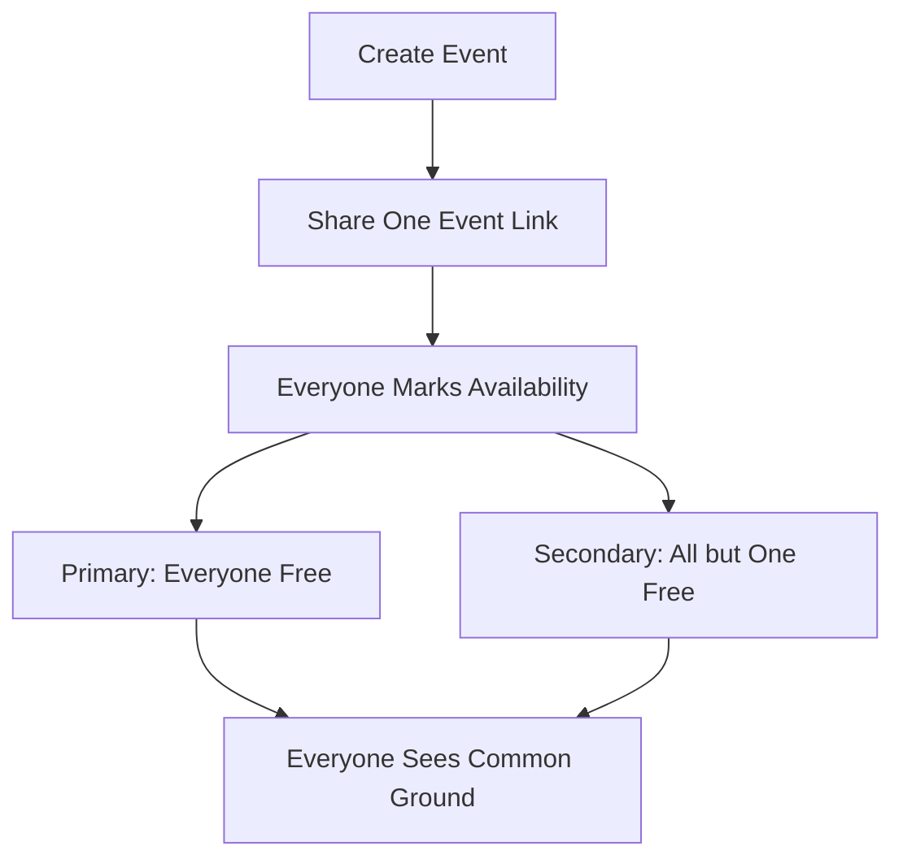

# Whenkin

**Find your shared time.**

Whenkin helps a group find a time to meet. Create an event, share one link, and let everyone mark when they are free. Everyone sees the same event page, group responses, and Common Ground.


## What It Does

- Works on computers and phones, in English, Simplified Chinese, and Spanish.
- Choose specific dates or days of the week. There is no meeting-length setting.
- Detects your device’s time zone and offers a searchable selector.
- Drag across empty blocks to mark availability, or marked blocks to clear it. Choose Done to lock the grid and scroll.
- **Primary Selection:** everyone who has responded is free for the whole period.
- **Secondary Selection:** all but the same one person are free for the whole period.
- Shows all matching periods, with primary matches first.
- Has no participant limit. Empty saved responses count as unavailable.
- Uses one event link for everyone. A separate private edit link protects each person’s own response.
- Links expire one calendar year after the event is created.

Public website: https://whenkin.j4ouyang.chatgpt.site

## How It Works



See [the flowchart](docs/flowchart.md) and [project structure](docs/architecture.md) for more detail.

## Time Zones and Storage

React and TypeScript provide the interface. ChatGPT Sites hosts the website and API. Neon PostgreSQL saves events and responses. Date-based availability uses `timestamptz`: PostgreSQL stores real instants, without separate local-time copies. Display-zone changes preserve those instants.

Weekday polls describe a typical week, not recurring appointments. Their shared-clock coordinate week and time-zone conversion remain unchanged. All range comparisons use numeric timestamps. The server calculates Common Ground once; the browser displays it.

Everyone with an event link can see all saved names, time zones, availability, and results. Each visit to the ordinary event link starts a blank personal response, even in the same browser. Use Your Availability to mark your own times, or Group Availability to see everyone’s saved times together. Keep your private edit link to return to your response on any browser. Copy it from Share Event or the bottom of the page. A private response token is still required to change a response. Old organizer fragments no longer grant a different view. No account is needed.

## Manual Cleanup

There is no automatic cleanup schedule. A link stops working at its one-year deadline even if its data has not yet been removed.

With the server-only `DATABASE_URL` set in your terminal environment:

```sh
npm run db:cleanup -- --dry-run
npm run db:cleanup
```

The first command reports how many events are at least one calendar year old. The second deletes all eligible events in small batches, along with their dates, responses, and availability. It leaves younger events intact. `cleanupExpiredEvents(query)` is also exported from `scripts/cleanup.mjs` for manual use in code.

See [retention and cleanup](docs/retention.md). Never put database credentials in GitHub or browser code.

## Development

Use Node.js 22.13 or newer. Install dependencies with `npm run install:ci`, configure an ignored local `.dev.vars` file with `DATABASE_URL`, and apply migrations with `npm run db:migrate`. Start the website with `npm run dev`.

Apply migrations `007_shared_events.sql` and `008_manual_cleanup_by_age.sql` before publishing the shared-event version. It extends existing events to one year from their original creation, removes the response cap, and makes cleanup manual. Historical meeting-length and organizer-token columns remain unused for safe deployment compatibility; no current feature reads them.

Run `npm run check`, `npm test`, and `npm run build`. Tests cover shared visibility, private response editing, primary and secondary matches, time zones, weekday polls, unlimited participants, expiry, and manual cleanup.

[Terms of Use](https://whenkin.j4ouyang.chatgpt.site/terms) and [Privacy Policy](https://whenkin.j4ouyang.chatgpt.site/privacy) describe the shared visibility and retention rules. UCSD CSSA operates Whenkin; contact j4ouyang@ucsd.edu for data requests.

Source: https://github.com/jimmy181211/whenkin
