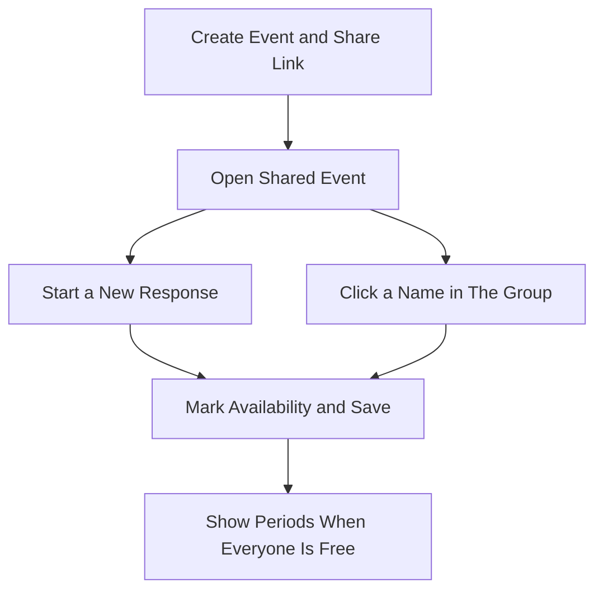
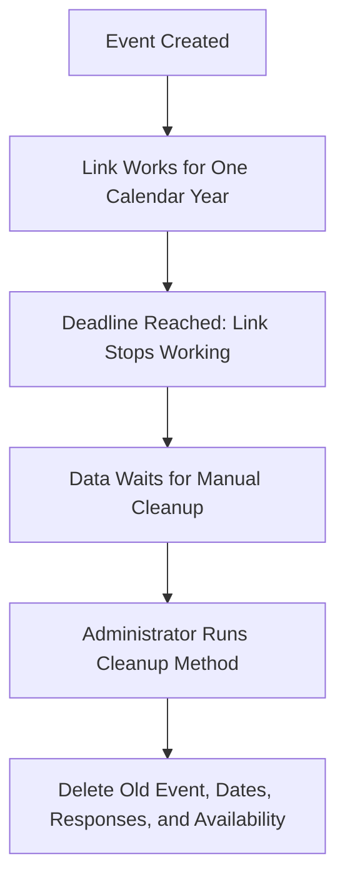

# How Whenkin Works

Everyone uses the same event link. Anyone with the link can view and edit all responses.

## Shared Event Flow

There is no meeting-length setting or participant limit. Only saved responses enter the calculation. An empty response counts as unavailable. Common Ground includes only periods when every respondent is free for the whole period; gaps remain separate.

## Viewing and Editing

Your Availability shows the response being edited. Group Availability shows a high-contrast map of how many saved respondents are free at each time. Click a name in The Group to edit that response from any browser. Add Response starts a new blank form. Private edit links are no longer used.

Enter a name before marking a new response. A brief hint appears above the name field if needed. Changes save automatically, and switching members waits for the current save. The server rejects stale revisions so one visitor cannot accidentally overwrite a newer edit. Select that person again to reload after a conflict.

Times remain UTC instants in PostgreSQL and display in the chosen time zone. Date and weekday modes, English, Chinese, and Spanish keep the same scheduling data.

## Expiry and Manual Cleanup

Editing does not extend the deadline. Cleanup removes only events whose creation anniversary is at least one year ago. It processes batches until finished, preserving younger events. There is no scheduled ChatGPT task or automatic backend job.
