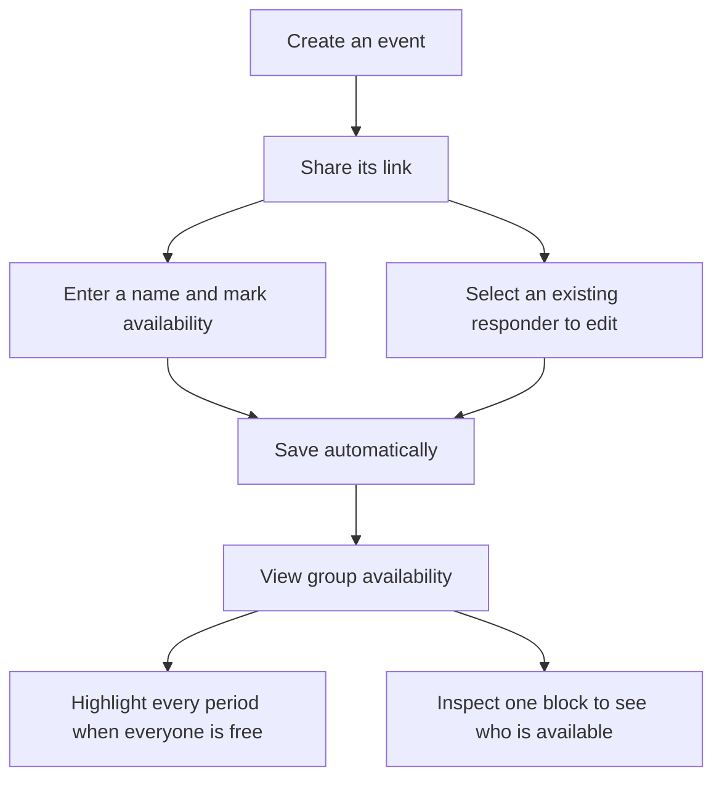

# How Whenkin works

Everyone uses one shared event link. Anyone with the link can view and edit saved responses.

There is no meeting-length setting or participant cap. Empty saved responses count as unavailable. Everyone-free results include only the intersection of all saved responses, and gaps remain separate. Block inspection remains available independently of the highlight toggle.

The browser sends HTTP requests to Express. The endpoint validates input, executes the existing PostgreSQL operation and returns JSON. The browser refreshes the displayed result. Revision checks reject stale edits and deletions.

Date-based ranges remain UTC instants. Typical-week polls keep their reference-week encoding. Language changes affect presentation without changing stored scheduling data.

Links stop working one calendar year after creation; editing does not extend that deadline. Data remains until an administrator runs the manual cleanup tool. Cleanup deletes eligible event rows and their child rows, preserving younger events. It is not run by visitor requests or an automatic timer.
