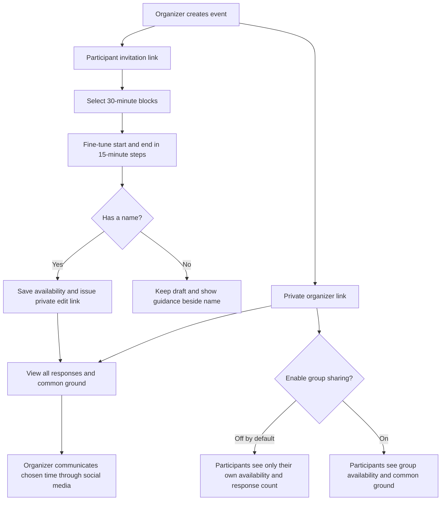
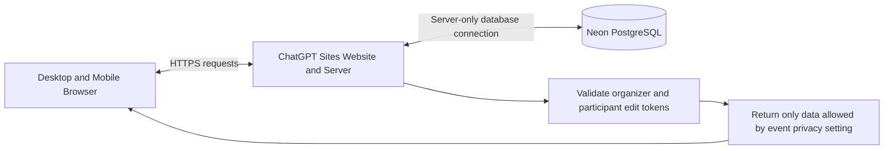
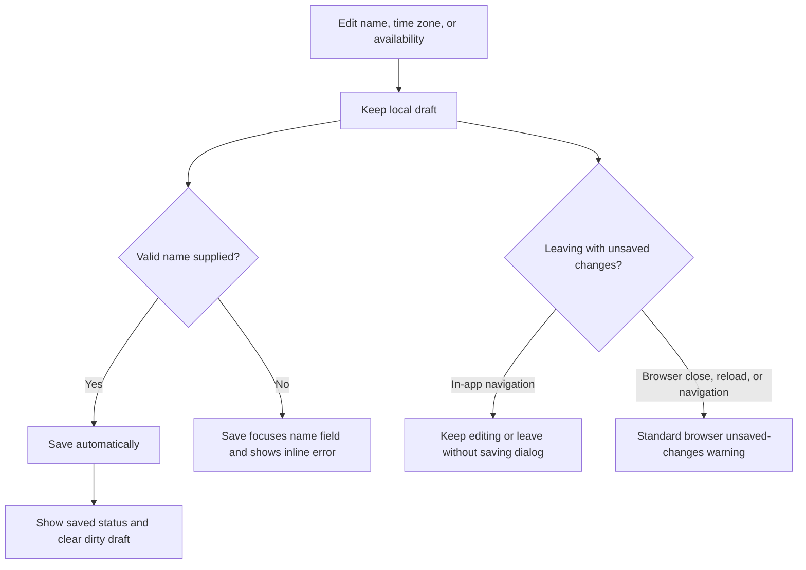

# How Whenkin Works

Whenkin collects availability. The organizer compares responses and communicates the final arrangement outside the website.

## Organizer and Participant Access

## Website and Storage

The website is public. Event access permissions are enforced by the server independently of the site's public audience. Private tokens stay in link fragments and local browser storage; requests authenticate with an authorization header. Neon stores token hashes, availability ranges as actual UTC instants, and the event privacy setting.

## Editing and Navigation

English and Spanish interface titles use Title Case. English, Simplified Chinese, and Spanish share the same scheduling data. Time-zone changes only change clock labels; 30-minute display blocks retain the original 15-minute precision, including partial blocks and repeated daylight-saving hours.
