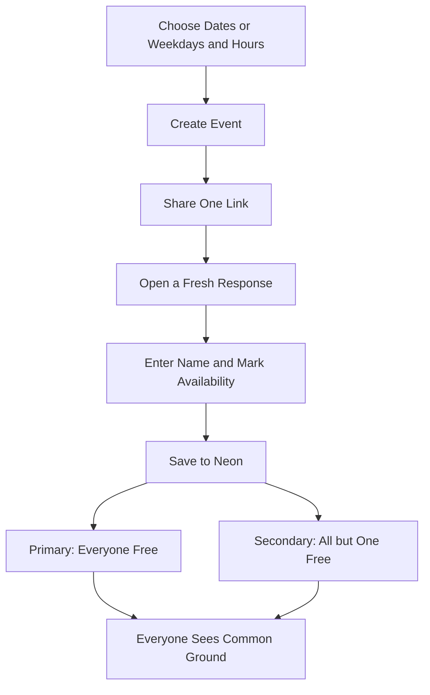
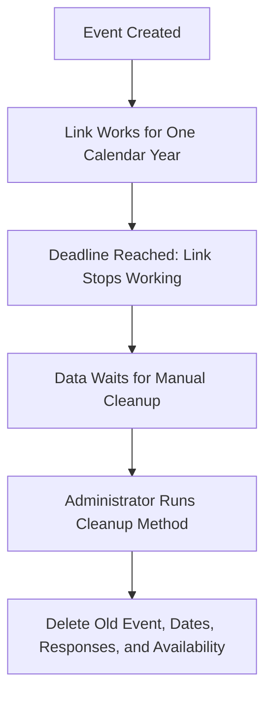

# How Whenkin Works

Everyone uses the same event link and sees the same page. Each person keeps a private link for editing their own response.

## Shared Event Flow

There is no meeting-length setting and no participant limit. Only saved responses enter the calculation. An empty response counts as unavailable. Times are shown in the viewer’s selected time zone.

## Finding Common Ground

The server sorts the start and end of availability ranges. At each boundary it updates who is free. It combines touching periods only if the available group stays the same.

A primary result includes every respondent. A secondary result excludes exactly one fixed respondent for its entire duration. A result never joins two halves where different people are missing. Gaps remain separate. Primary results come first, then secondary results, without discarding later matching periods.

## Saving and Editing

The grid switches between Your Availability and Group Availability. The personal view is always editable after entering a name; a brief, nonblocking toast explains this when needed. The group view shows saved availability counts and cannot edit responses. Changes save automatically. Every ordinary event-link visit starts a blank personal response, including in the same browser. Only an explicit private edit URL restores that person. Copy it from Share Event or the bottom of the page. Before the first saved response, either copy button shows a brief reminder to edit and save availability first. No response identity or draft is restored from browser storage. Only a valid private response token can update that response. Viewing the group does not grant permission to change anyone else’s selections.

Date mode stores real instants in PostgreSQL `timestamptz`. Weekday mode retains its existing reference-week projection. Display-zone changes preserve availability. English, Chinese, and Spanish use the same scheduling data.

## Expiry and Manual Cleanup

Editing does not extend the deadline. Cleanup removes only events whose creation anniversary is at least one year ago. It processes batches until finished, preserving younger events. There is no scheduled ChatGPT task or automatic backend job.
