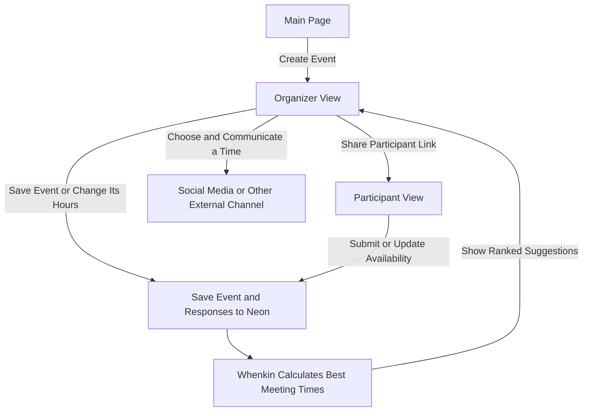
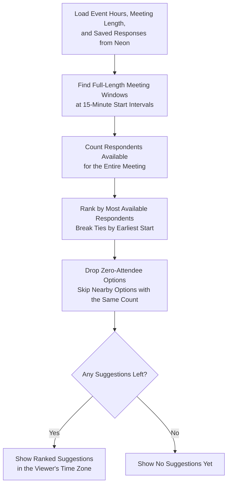
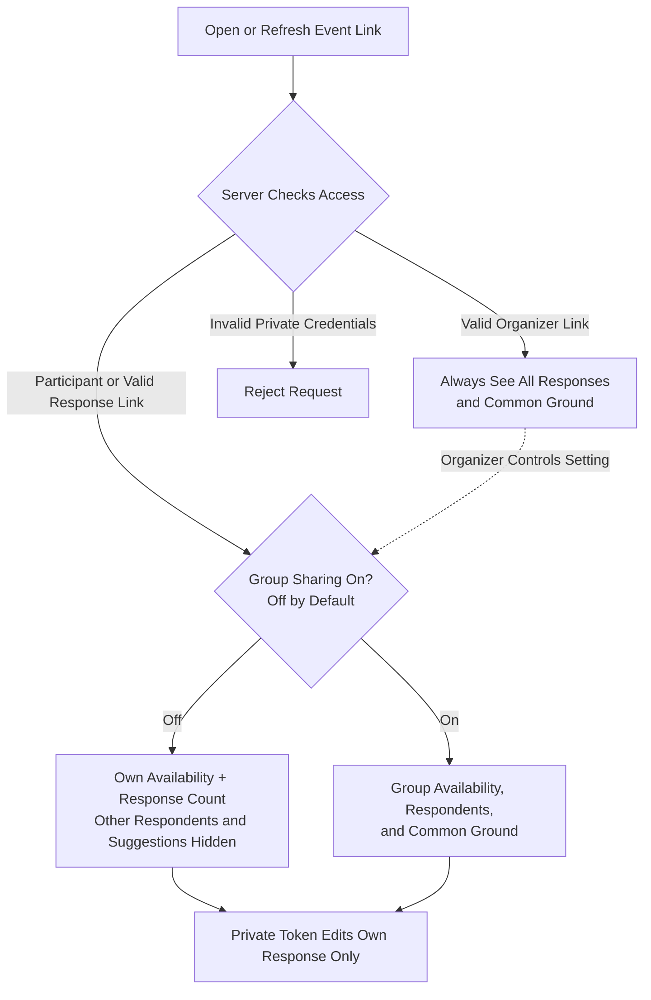
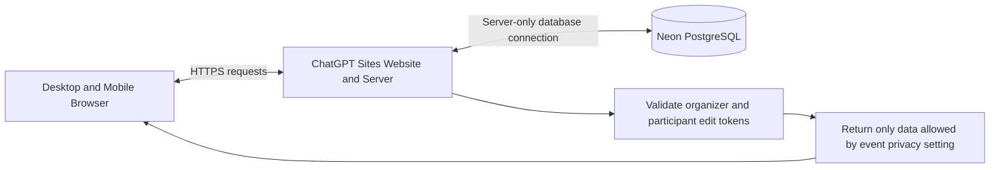
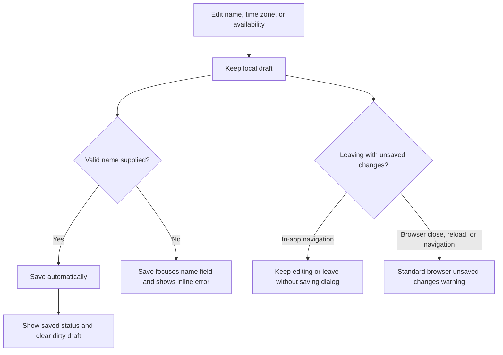

# How Whenkin Works

Whenkin collects availability. The organizer compares responses and communicates the final arrangement outside the website.

## Big Picture

Creating an event saves its details and opens the organizer view. Responses and event changes feed the same stored event; Whenkin returns updated suggestions for the full meeting length. Existing invitation and private edit links continue to work.

See [Calculating the Best Meeting Time](#calculating-the-best-meeting-time) for ranking, [Participant Privacy](#participant-privacy) for access rules, [Website and Storage](#website-and-storage) for storage details, and [Editing and Navigation](#editing-and-navigation) for saving and returning home.

## Calculating the Best Meeting Time

The single Neon step uses the event's current saved data; see [Website and Storage](#website-and-storage). Overlapping or touching event windows are combined before calculation. Candidate starts are 15 minutes apart, even though the selection grid uses 30-minute blocks. Each candidate must fit the entire meeting length within the event hours.

Only people who have responded enter the count. A person counts as available only when their saved availability covers the whole meeting; separate people's partial availability cannot be combined to cover it. **Best Fit** means the highest attendance count, with the earliest start breaking a tie. It does not require everyone to be available.

To keep the list useful, skip a candidate if a kept suggestion has the same attendee count and starts less than one meeting length away. Keep up to 20 suggestions, show five initially, and reveal five more at a time. Times are displayed in the viewer's chosen time zone. The organizer can always view these results; participant access follows [Participant Privacy](#participant-privacy).

## Participant Privacy

The organizer controls **Let participants see group availability**. It is **off by default**. The server applies this setting before sending response data to the browser.

| Access | Group Sharing Off | Group Sharing On | Editing Rights |
| --- | --- | --- | --- |
| Organizer with a valid private organizer link | All responses and common ground | All responses and common ground | Change event hours, meeting length, and group-sharing setting |
| Participant invitation link without a private response token | Event details, response count, and the participant's local draft | Event details, response count, and group view | Submit a new response; an existing response still requires its own private edit token |
| Participant with a valid private response edit link | Own saved response and response count | Own response plus group view | Edit only the response belonging to that token |

With sharing off, the API excludes other respondents' names, time zones, and availability, and returns no common-ground suggestions. The participant page hides the Group Availability tab, common-ground panel, and respondent list. The organizer retains access to all responses.

Sharing changes visibility; it does not grant permission to edit another response or delete existing responses. Only the organizer can change the setting. Invalid private credentials are rejected. A name alone does not grant access to a saved response.

The same participant and private edit links continue to work when the organizer changes the setting. The server reevaluates access on each request; open pages refresh every ten seconds and when focused.

## Website and Storage

The website is public. Event access permissions are enforced by the server independently of the site's public audience. Private tokens stay in link fragments and local browser storage; requests authenticate with an authorization header. Neon stores token hashes, availability ranges as actual UTC instants, and the event privacy setting.

## Editing and Navigation

English and Spanish interface titles use Title Case. English, Simplified Chinese, and Spanish share the same scheduling data. Time-zone changes only change clock labels; 30-minute display blocks retain the original 15-minute precision, including partial blocks and repeated daylight-saving hours.

## Editing Event Hours

The private organizer page can change From, Until, and Meeting Length after creation. Hours apply to every existing event date in the event time zone. Saving atomically replaces the event windows, clips saved availability to their intersection, increments schedule and response revisions, and retains the same invitation and private edit links. Old schedule submissions are rejected so stale tabs cannot restore removed times. Open pages refresh every ten seconds and when focused; unsaved participant drafts are clipped to the new windows.
