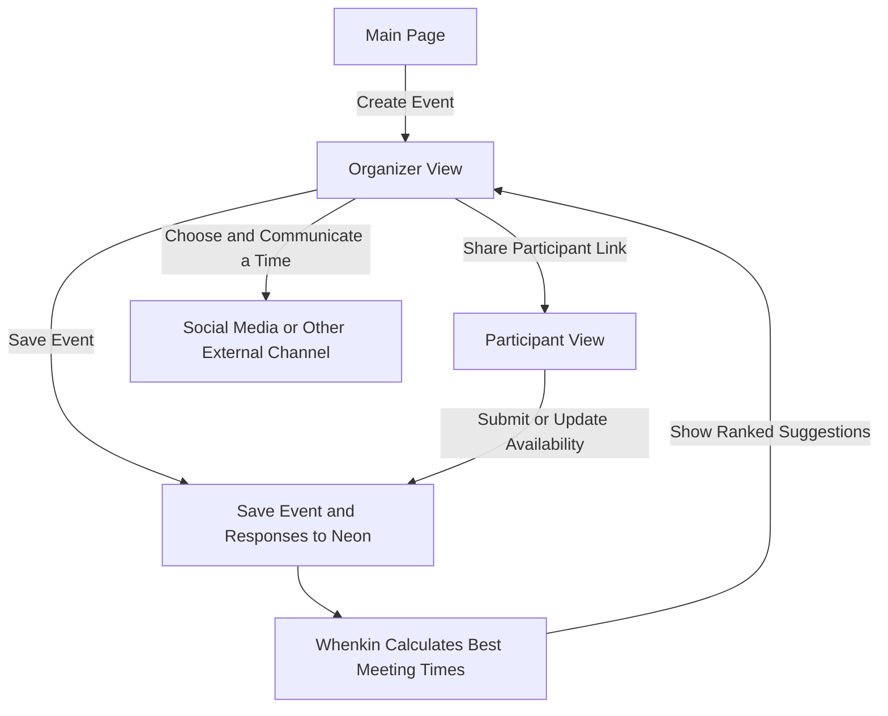
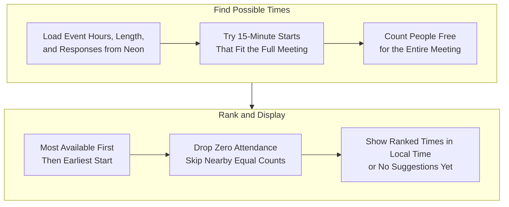
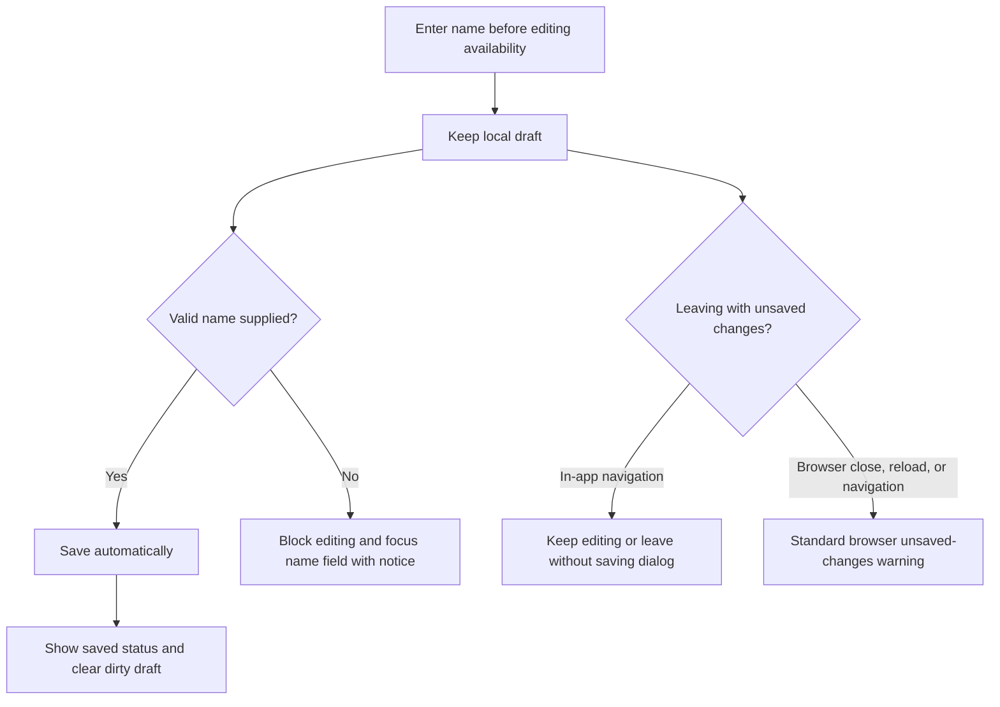
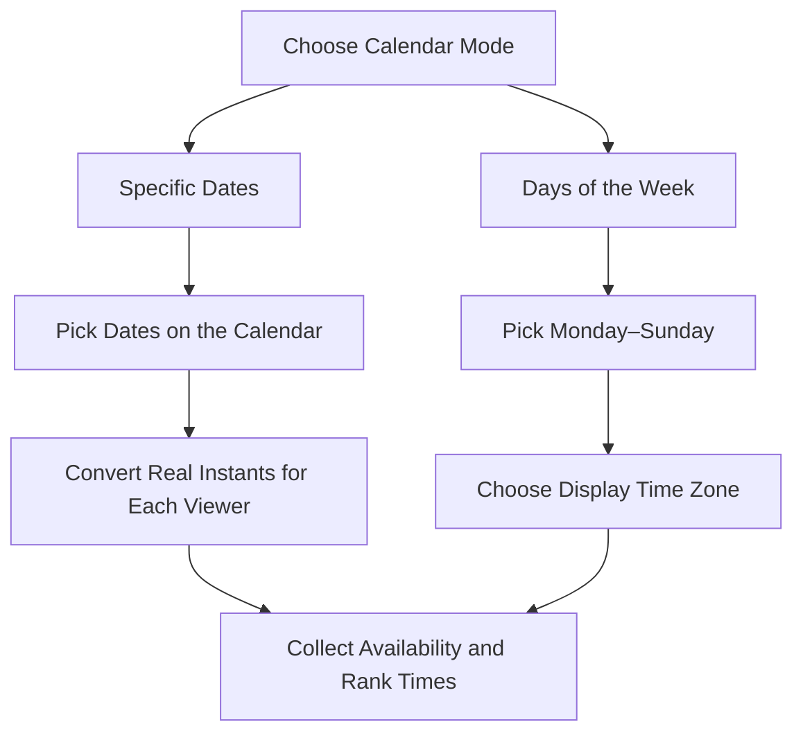

# How Whenkin Works

Whenkin collects availability. The organizer compares responses and communicates the final arrangement outside the website.

## Big Picture

Creating an event saves its details and opens the organizer view. Responses feed the same stored event; Whenkin returns updated suggestions for the full meeting length. Existing invitation and private edit links continue to work.

See [Calculating the Best Meeting Time](#calculating-the-best-meeting-time) for ranking, [Participant Privacy](#participant-privacy) for access rules, [Website and Storage](#website-and-storage) for storage details, and [Editing and Navigation](#editing-and-navigation) for saving and returning home.

## Calculating the Best Meeting Time

The single Neon step uses the event's current saved data; see [Website and Storage](#website-and-storage). Overlapping or touching event windows are combined before calculation. Candidate starts are 15 minutes apart, even though the selection grid uses 30-minute blocks. Each candidate must fit the entire meeting length within the event hours.

Only people who have responded enter the count. A person counts as available only when their saved availability covers the whole meeting; separate people's partial availability cannot be combined to cover it. **Best Fit** means the highest attendance count, with the earliest start breaking a tie. It does not require everyone to be available.

To keep the list useful, skip a candidate if a kept suggestion has the same attendee count and starts less than one meeting length away. Keep up to 20 suggestions, show five initially, and reveal five more at a time. Times are displayed in the viewer's chosen time zone. The organizer can always view these results; participant access follows [Participant Privacy](#participant-privacy).

## Participant Privacy

Participants see their own saved response and the response count. Only the organizer sees all responses, participant names, and ranked meeting suggestions. The availability grid always edits the current person's response; there are no personal/group tabs or sharing setting.

A valid private response token is required to load or update that person's saved availability. A valid organizer token is required to see all responses and suggestions. Event hours are set at creation; there is no event-hour editor or schedule-update API. Legacy sharing flags do not grant access.

## Website and Storage

The website is public. Event access permissions are enforced by the server independently of the site's public audience. Private tokens stay in link fragments and local browser storage; requests authenticate with an authorization header. Neon stores token hashes, availability ranges, and event/response revisions. Date-based ranges are actual UTC instants. Weekday ranges encode a typical shared-clock week; see the mode explanation below.

## Editing and Navigation

English and Spanish interface titles use Title Case. English, Simplified Chinese, and Spanish share the same scheduling data. Time-zone changes preserve the saved selection; 30-minute display blocks retain the original 15-minute precision, including partial blocks and repeated daylight-saving hours.

## Editing Availability

Dates or weekdays, event hours, and meeting length are fixed when an event is created. Organizers and participants can continue editing their own availability. Open pages refresh responses every ten seconds and when focused. Existing event links and saved availability are preserved.

On computers and phones, use the Edit/Done switch. In Edit, start on an empty block to mark availability or a marked block to clear it; that action stays the same for the whole drag. In Done, the grid is locked and scrolls without changing availability. The time-label column also scrolls while editing. The fine-tune panel is removed. Mobile 30-minute blocks are 26 pixels high by default; desktop blocks remain 32 pixels high. The wider mobile grid uses smaller outer margins.

## Choosing Dates or Weekdays

Date-based events retain UTC comparisons and local-time display. Weekday polls describe a typical week, not repeating calendar appointments. They retain the organizer’s clock as their storage coordinates, but every viewer can change the displayed time zone. Conversions use the offsets at the poll’s creation time; daylight-saving changes can alter the difference. Their stored ranges encode a fixed Monday–Sunday coordinate week rather than real appointment dates. Existing events stay date-based. The mode switch on the creation form preserves both date and weekday choices.

The name hint sits directly below the participant input on both desktop and mobile. An empty or whitespace-only name locks grid editing, including mouse, touch, keyboard, and Undo. Attempting Edit or a cell focuses the name input and shows an accessible notice. The former late save-time name error is removed; the API still requires a valid participant name. Changing time zones remains available before entering a name.
