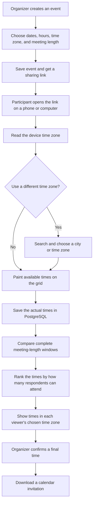
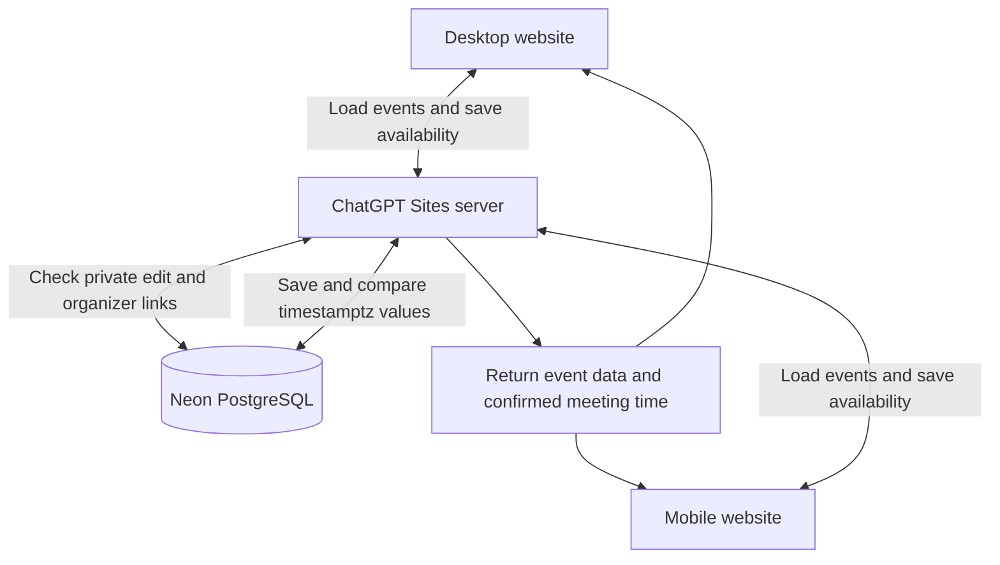
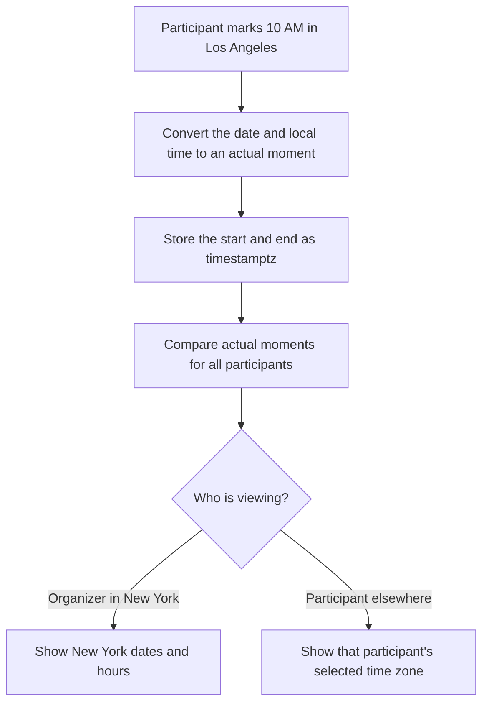

# How Whenkin works

Whenkin helps people choose a meeting time without a long conversation about who is free.

## The organizer and participants

## The website and database

The phone and computer use the same website, server, and database.

## What happens to a time

Changing the display zone never moves availability. It only changes the clock labels. The event keeps the organizer’s time-zone preference so it can be used again later.
